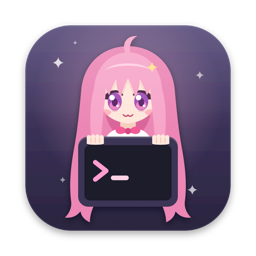
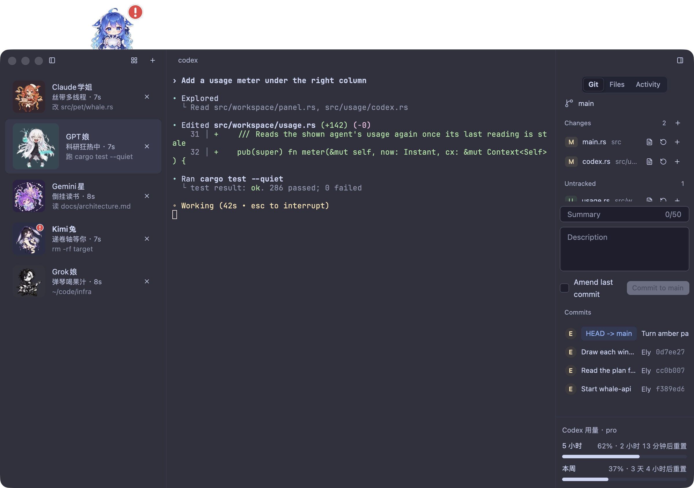

<p align="center">
  
</p>

<h1 align="center">Ely Tea Party</h1>

<p align="center">
  <b>A terminal where your coding agents come to tea.</b><br>
  Each session's agent shows as an animated chibi girl who does what it does:<br>
  types while it works, reads while it searches, raises her hand when it waits for you, and naps when it's done.
</p>

<p align="center">
  <a href="https://github.com/ELY-Open-Source/ely-tea-party/releases/latest"></a>
  <a href="https://github.com/ELY-Open-Source/ely-tea-party/actions/workflows/ci.yml"></a>
  <a href="https://github.com/ELY-Open-Source/ely-tea-party/releases"></a>
  
  
  <a href="LICENSE"></a>
</p>

<p align="center">
  
</p>

Ely Tea Party is a fork of [ELYTerminal](https://github.com/ELY-Open-Source/ELYTerminal) by Zachary Zhang, made with their permission. The terminal, its engine and its design are theirs; this fork adds one opinion on top: **a terminal for running coding agents**, where a glance at the left column tells you who is working, who is thinking and who is waiting for you.

## Meet the party

<table align="center">
  <tr>
    <td align="center"><br><b>Claude学姐</b><br><code>claude</code></td>
    <td align="center"><br><b>GPT娘</b><br><code>codex</code></td>
    <td align="center"><br><b>鲸鱼娘</b><br><code>dscode</code> <code>deepseek</code></td>
    <td align="center"><br><b>Grok娘</b><br><code>grok</code></td>
  </tr>
  <tr>
    <td align="center"><br><b>Kimi兔</b><br><code>kimi</code></td>
    <td align="center"><br><b>Gemini星</b><br><code>gemini</code> <code>agy</code></td>
    <td align="center"><br><b>Pi酱</b><br><code>pi</code> <code>omp</code></td>
    <td align="center"><br><b>OpenCode娘</b><br><code>opencode</code></td>
  </tr>
</table>

Each girl has eight animations: working, researching, her special move, slacking off, thinking, waiting for you (with a red "!"), idle and asleep.

## Highlights

- 🫖 **Characters that know what their agent does.** With zero setup a character appears for any agent in a session's foreground. One command installs hooks for every agent you have, and then her row says exactly what it's doing: `改 src/pet/whale.rs`, `跑 cargo test`, `递卷轴等你`. At the moments that matter she says a line of her own.
- 🐋 **The whale girl peeks over your window.** She follows your sessions: busy at her laptop while an agent works, a hand up while one waits for you, a water spout when it finishes. Leave the app alone and she sneaks a snack, strolls over to read your terminal without understanding a word of it, slacks off with chips, and after five minutes falls asleep.
- 📊 **Your plan's usage, right there.** The right column's foot shows how much of the shown agent's subscription is left: Claude Code's 5-hour and weekly windows, Codex's windows and credits, and when each resets.
- 🐋 **Local task cards, optional AI.** Click the whale to see who needs you, recent hook-reported tasks and terminal links without using AI tokens. Enable AI explanations in Settings to explain one short terminal excerpt on demand; unchanged excerpts reuse the last answer. See [Agent Butler](docs/butler.md).
- 🍰 **The tea party.** <kbd>Cmd</kbd>+<kbd>Shift</kbd>+<kbd>O</kbd> shows every session as a card at one table, so you see who needs you at a glance.
- 🗄️ **A drawer under every session.** <kbd>Cmd</kbd>+<kbd>J</kbd> opens your own shell under the agent's, in the same folder, for the odd command.
- ♻️ **Sessions come back.** Quit and reopen: every session returns to its folder, and each agent resumes its conversation.
- 📜 **An activity timeline.** The right column's Activity tab lists the shown agent's steps: each prompt, each tool and how long it took, each question.
- 🖥️ **A real terminal underneath**, on `alacritty_terminal`: truecolor, the kitty keyboard protocol, input methods, OSC 8 links, prompt marks and jumps, system notifications, Git and Files panels, blur and 14 themes, on macOS, Windows and Linux.

## Install

Grab the latest build from [Releases](https://github.com/ELY-Open-Source/ely-tea-party/releases/latest).

From 0.3.4 on, the app checks Releases itself, unless Settings › Terminal › Check for updates automatically is off: when a newer version is out, a button in the title bar says so. On macOS one press downloads it, checks its signature and puts it in place, and a second press restarts into it; on Windows and Linux the button opens the release's page.

| Platform | Build | |
|---|---|---|
| macOS 11+, Apple silicon | `ely-tea-party-VERSION.dmg` | Signed with Developer ID and notarized: open it and drag Ely Tea Party into Applications. |
| Windows 10+, x86_64 | `ely-tea-party-VERSION-windows-x86_64.zip` | Unsigned: unzip and run `ely-tea-party.exe`; if SmartScreen stops it, press More info, then Run anyway. |
| Linux x86_64, glibc 2.35+ | `ely-tea-party-VERSION-linux-x86_64.tar.gz` | Needs libxkbcommon, libxkbcommon-x11 and libxcb; see below. |

```sh
tar -xzf ely-tea-party-VERSION-linux-x86_64.tar.gz
cd ely-tea-party-VERSION-linux-x86_64
install -Dm755 ely-tea-party -t ~/.local/bin
install -Dm644 net.toddzheng.ely-tea-party.desktop -t ~/.local/share/applications
install -Dm644 net.toddzheng.ely-tea-party.svg -t ~/.local/share/icons/hicolor/scalable/apps
```

The desktop entry runs `ely-tea-party`, so `~/.local/bin` must be on `PATH`. Characters show on macOS and Linux; Windows does not detect agents yet.

## Hook up your agents

Characters work out of the box: once a second each session's foreground job is read (`node …/codex` and `npx @openai/codex` included), and an agent there gets its character, guessed busy while it draws and idle when quiet. For the exact state on macOS and Linux, open **Settings → Terminal → Agent hooks → Install hooks**. The button uses your login shell to find installed agents, shows the installation results, and can be run again after an update. Restart running agents afterward. The command line also supports installing hooks:

```sh
ely-tea-party hooks install              # every agent found on PATH
ely-tea-party hooks install codex kimi   # or just these
```

It covers Claude Code, Codex, Gemini, Antigravity, Grok, Kimi Code and dscode, plus plugins for OpenCode, Pi and oh-my-pi. Each file it changes is backed up first as `NAME.ely-tea-party.bak`, and running it again changes nothing. The hooks do nothing in any other terminal. On macOS, the app's command line is inside the bundle: `/Applications/Ely\ Tea\ Party.app/Contents/MacOS/ely-tea-party`.

**Settings → Characters** lets you replace every agent character and the whale mascot with your own PNG, APNG, GIF or WebP. Import one image for all states, customize individual actions, preview them, adjust the mascot's size and position, or share a complete `.elyskin` pack. Missing actions use your custom idle image. Imported images are saved inside the app's configuration directory, and each character can be restored independently. See [Character skins](docs/character-skins.md) for the pack format and image limits.

Fast sessions light the terminal edges while the agent works: Claude uses its warm copper color and Codex its green. Codex Ultrafast adds faster green/cyan long trails, counter-rotating sparks, and softly pulsing corners. They stop while idle or awaiting input, and become a faint static edge with Reduce Motion. Run `ely-tea-party hooks install claude codex` again after upgrading, then restart those agents. Claude's status-line command forwards its session's `fast_mode` while preserving your existing command and output. Codex's title gains its `fast-mode` field while keeping your other title items; an explicitly empty title stays disabled.

For a new local Codex process, Ely snapshots its own `CODEX_HOME`, selected profile file, trusted project config, and command-line overrides to estimate the startup mode, even with terminal titles disabled. The session row labels this `Fast (configured)` or `Ultrafast (configured)` until a live report arrives. This is configured mode, not measured throughput or guaranteed backend speed. The snapshot is read once; another terminal changing shared defaults does not change this session. Remote connections, resumed/forked sessions, legacy inline profiles, and ambiguous project trust wait for a live signal instead.

Tested with Codex 0.163: its title reports `Fast on`, but `Fast off` also covers Ultrafast. Ely recognizes subsequent switches from the CLI's styled `Service tier set to ultrafast` (or `priority` / `default`) confirmation. Live reports replace startup estimates. Unknown modes never animate; reasoning effort is not a speed signal. Claude's status-line `fast_mode` reports its startup mode too, once the status-line integration is installed.

## The whale girl

<p align="center">
  
</p>

At rest she just stands there. After a minute with nothing happening she sneaks a snack, takes a stroll and slacks off by turns, and after five she falls asleep. On her stroll she walks along the edge to a spot over the terminal, peers at it, down from the top edge or up from the bottom one, can't make head or tail of it, and walks back; anything that wakes her sends her hurrying home. Typing in a terminal, a click in the window or any change in your sessions wakes her; click her for her special move, or drag her along the edge to move her. Settings › Terminal › **Mascot** hides her, and **Who peeks** brings back upstream's Ely in her place.

## Keys

Settings › Terminal lists them all, as your platform binds them.

| | macOS | Windows and Linux |
|---|---|---|
| New session | <kbd>Cmd</kbd>+<kbd>T</kbd> | <kbd>Ctrl</kbd>+<kbd>Shift</kbd>+<kbd>T</kbd> |
| Close session | <kbd>Cmd</kbd>+<kbd>W</kbd> | <kbd>Ctrl</kbd>+<kbd>Shift</kbd>+<kbd>W</kbd> |
| Session 1 to 8, last | <kbd>Cmd</kbd>+<kbd>1</kbd>…<kbd>8</kbd>, <kbd>9</kbd> | <kbd>Alt</kbd>+<kbd>1</kbd>…<kbd>8</kbd>, <kbd>9</kbd> |
| Next, previous session | <kbd>Ctrl</kbd>+<kbd>Tab</kbd>, <kbd>Ctrl</kbd>+<kbd>Shift</kbd>+<kbd>Tab</kbd> | the same |
| Jump to an agent waiting for you | <kbd>Cmd</kbd>+<kbd>Shift</kbd>+<kbd>U</kbd> | <kbd>Ctrl</kbd>+<kbd>Shift</kbd>+<kbd>U</kbd> |
| Tea party | <kbd>Cmd</kbd>+<kbd>Shift</kbd>+<kbd>O</kbd> | <kbd>Ctrl</kbd>+<kbd>Shift</kbd>+<kbd>O</kbd> |
| Drawer | <kbd>Cmd</kbd>+<kbd>J</kbd> | <kbd>Ctrl</kbd>+<kbd>Shift</kbd>+<kbd>J</kbd> |
| Sessions column, right column | <kbd>Cmd</kbd>+<kbd>B</kbd>, <kbd>Cmd</kbd>+<kbd>Alt</kbd>+<kbd>B</kbd> | <kbd>Ctrl</kbd>+<kbd>Shift</kbd>+<kbd>B</kbd>, <kbd>Ctrl</kbd>+<kbd>Shift</kbd>+<kbd>Alt</kbd>+<kbd>B</kbd> |
| Previous, next prompt | <kbd>Cmd</kbd>+<kbd>↑</kbd>, <kbd>Cmd</kbd>+<kbd>↓</kbd> | <kbd>Ctrl</kbd>+<kbd>Shift</kbd>+<kbd>↑</kbd>, <kbd>Ctrl</kbd>+<kbd>Shift</kbd>+<kbd>↓</kbd> |
| Copy, paste | <kbd>Cmd</kbd>+<kbd>C</kbd>, <kbd>Cmd</kbd>+<kbd>V</kbd> | <kbd>Ctrl</kbd>+<kbd>Shift</kbd>+<kbd>C</kbd>, <kbd>Ctrl</kbd>+<kbd>Shift</kbd>+<kbd>V</kbd>; on Windows <kbd>Ctrl</kbd>+<kbd>V</kbd> too |
| Select all, find | <kbd>Cmd</kbd>+<kbd>A</kbd>, <kbd>Cmd</kbd>+<kbd>F</kbd> | <kbd>Ctrl</kbd>+<kbd>Shift</kbd>+<kbd>A</kbd>, <kbd>Ctrl</kbd>+<kbd>Shift</kbd>+<kbd>F</kbd> |
| Bigger, smaller, reset size | <kbd>Cmd</kbd>+<kbd>=</kbd>, <kbd>Cmd</kbd>+<kbd>-</kbd>, <kbd>Cmd</kbd>+<kbd>0</kbd> | <kbd>Ctrl</kbd>+<kbd>=</kbd>, <kbd>Ctrl</kbd>+<kbd>-</kbd>, <kbd>Ctrl</kbd>+<kbd>0</kbd> |
| Open a link | <kbd>Cmd</kbd>+click | <kbd>Ctrl</kbd>+click |
| Settings | <kbd>Cmd</kbd>+<kbd>,</kbd> | <kbd>Ctrl</kbd>+<kbd>,</kbd> |
| Quit | <kbd>Cmd</kbd>+<kbd>Q</kbd> | <kbd>Ctrl</kbd>+<kbd>Shift</kbd>+<kbd>Q</kbd> |

## Settings

Every setting has a control in the settings window, which saves each change at once to `settings.json`:

- macOS: `~/Library/Application Support/ely-tea-party/settings.json`
- Linux: `$XDG_CONFIG_HOME/ely-tea-party/settings.json`, else `~/.config/ely-tea-party/settings.json`
- Windows: `%APPDATA%\ely-tea-party\settings.json`

A file that does not parse, or holds a value out of range, stops the start with an error naming the file and the field; the app never overwrites it. Ely Tea Party keeps its own settings and app id (`net.toddzheng.ely-tea-party`), so it runs beside ELYTerminal.

## Build from source

Rust 1.95.0, which `rust-toolchain.toml` pins; rustup installs it on the first build.

```sh
cargo run --release
```

On Linux, install the libraries gpui links first. On Debian and Ubuntu:

```sh
sudo apt-get install pkg-config libwayland-dev libxkbcommon-dev libxkbcommon-x11-dev \
  libxcb1-dev libx11-xcb-dev libfontconfig-dev libfreetype-dev
```

Each platform's script builds its release in `target/release`: `scripts/mac-app.sh` builds `Ely Tea Party.app` and a disk image (`DEV=1` builds `Ely Tea Party (dev).app` to sit beside a release), `scripts/windows-zip.ps1` zips `ely-tea-party.exe`, and `scripts/linux-tar.sh` builds in Docker and packs the binary with its desktop entry and icon. `scripts/check.sh` runs fmt, clippy, the tests and the 500-line rule; `AGENTS.md` lists the layout, the decisions and the tools.

The app logs to stderr: `RUST_LOG=ely_tea_party=debug` writes more, `trace` logs each paint. A Windows release build opens no console: `ely-tea-party.exe 2> log.txt` keeps its log.

<details>
<summary><b>Releasing</b></summary>

Dispatch the Release workflow on GitHub, which drafts `vVERSION` and puts the Linux and Windows builds on it. Then, on a Mac whose keychain holds a Developer ID Application identity, with an App Store Connect API key:

```sh
SIGN_IDENTITY="Developer ID Application: NAME (TEAMID)" \
NOTARY_KEY=~/.appstoreconnect/AuthKey_KEYID.p8 NOTARY_KEY_ID=KEYID NOTARY_ISSUER=ISSUER-UUID \
  scripts/mac-app.sh
scripts/release-asset.sh target/release/ely-tea-party-VERSION.dmg
```

</details>

<details>
<summary><b>Under the hood</b></summary>

- **Terminal.** `alacritty_terminal`: 256 colors and truecolor, bold, dim, italic, five underline styles, wide characters and combining marks. Box drawing, block elements and powerline shapes are drawn as geometry, so lines join across cells. Keys follow xterm and the kitty keyboard protocol, and on Windows win32-input-mode, so herdr's shortcuts work; input methods compose at the cursor; programs can track the mouse; pastes are bracketed when a program asks; OSC 8 and plain links open with the link press; find searches the scrollback. A scrollbar along the right edge scrolls the history, even while a program takes the wheel. A click on the line the shell reads moves its cursor there. Files dropped on the terminal type their paths, quoted for the session's shell. Fallback fonts cover characters the font lacks. On macOS, natural text editing, off by default in Settings › Terminal, sends Option and Command's arrows and deletes as the editing keys the shell expects.
- **Shell integration** for zsh, bash, fish and PowerShell, and on Windows for the bash, zsh or fish a Shell of `wsl` starts, so Files and Git follow a WSL session: each prompt reports its folder and title, and OSC 133 marks each prompt, each command and its exit status.
- **Sessions.** A double click on a row renames the session; an empty name gives it back its title. A bell marks a hidden session's row. A session without an agent shows a mark of what its programs report through OSC 7501, OSC 9;4 or herdr: waiting on you, an error, work with its progress, done or idle. Rows drag up and down to reorder, and a right press on one duplicates it, in the shell it runs and the folder it last reported, or closes it; long folders shorten fish-style, with the whole path on hover.
- **Notifications.** While the window is in the background or the session hidden, a session that starts waiting, finishes or fails, a command that ran 5 seconds or more ending, and a program's OSC 9, 777 or 99, post a system notification; a press shows the session. On macOS only the app bundle posts them.
- **Plan usage.** Codex's comes from the endpoint Codex's own usage display asks, every 2 minutes, with the ChatGPT login Codex keeps, sent the same way; while that cannot be asked, from Codex's session logs, marked with how old they are. Claude Code's comes from the endpoint its `/usage` asks, every 5 minutes, with the login Claude Code keeps, sent through `curl` so the token never appears in a process list; the app never refreshes that login.
- **Panels.** Files shows the session's folder as a tree with Git's marks. Git shows the branch, stages, unstages, discards, commits, lists recent commits and opens diffs, all through the `git` command line. Both side columns resize by dragging their border, and the window opens at the size it was left at.
- **Looks.** Ely Dark and Light, Catppuccin (all four), Tokyo Night, Dracula, Nord, Gruvbox Dark, Rosé Pine, Solarized Light, One Light and Kanagawa Wave, with a second theme while the system is dark; on Omarchy 4 an Omarchy theme follows the system's. Background opacity and blur through NSVisualEffectView on macOS, acrylic on Windows, `ext_background_effect_v1` or `org_kde_kwin_blur` on Wayland, and `_KDE_NET_WM_BLUR_BEHIND_REGION` on X11.

</details>

## Credits

- [ELYTerminal](https://github.com/ELY-Open-Source/ELYTerminal) by Zachary Zhang, the terminal this forks, and its [Ely components](https://github.com/ELY-Open-Source/Ely-GPUI-Components) on [GPUI](https://www.gpui.rs).
- The characters come from cmux-todd-ui, which draws the same girls for cmux; `scripts/agents.py` and `scripts/mascot.py` turn its art into the animations built into the app.
- The icon is the whale girl too, from cmux-todd-ui's `art/icon`; `scripts/icon.py` puts it on macOS's own icon shape. Keep the app open on a Mac and every so often she bites the terminal in your Dock.

## License

MIT, in [`LICENSE`](LICENSE), as upstream ELYTerminal; the fork keeps its copyright notice. Box drawing and key encoding follow Ghostty's code, MIT, in `LICENSE-GHOSTTY`. The theme files come from iTerm2-Color-Schemes, MIT, with its license in `assets/themes`. JetBrains Mono and its Nerd Font build are under the SIL Open Font License, in `assets/fonts`.

### Upstream synchronization

The fork includes ELYTerminal through `cf0211b` (2026-10-25), including v0.1.9. Settings now offer English or Simplified Chinese, a custom start folder, and switches for session dragging and context menus. The fork retains its characters, drawers, session restoration, Files actions and automatic installer. Some fork-specific labels remain in their original language.

Linux packaging supports tar.gz, DEB, RPM and AppImage; see [packaging instructions](packaging/linux/README.md). Package generation and platform validation are separate from publishing a release.
